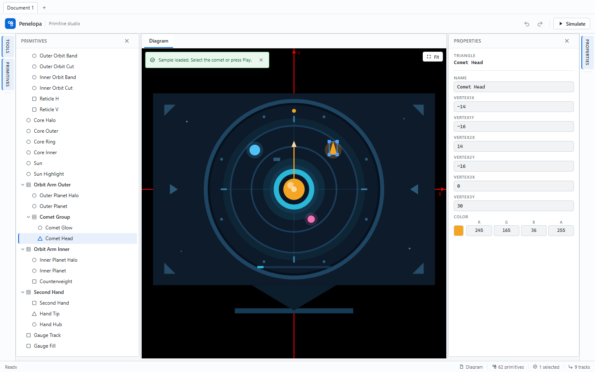
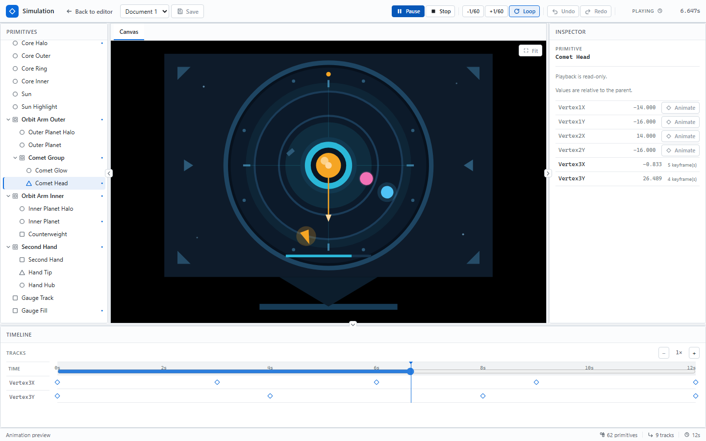

# Penelopa

English | [简体中文](README.md)

**A primitive alignment editor and keyframe simulation workspace for Blazor WebAssembly.**

**Positioning**: Blazor WASM developers and design validators who arrange primitives in the browser, apply six-direction alignment, and verify layout and animation with keyframe simulation; a static site with no server or database.
**Status**: 0.0.0-dev (active development on main), no versioned Release yet (evidence: no tags, empty Releases; `Version` in `Directory.Build.props` is `0.0.0-dev`). The live demo is deployed manually via `deploy-pages.yml` and may lag behind main.

[](https://github.com/HestiaLab/Penelopa/actions/workflows/ci.yml)
[](https://github.com/HestiaLab/Penelopa/actions/workflows/deploy-pages.yml)
[](LICENSE)

[Live demo](https://HestiaLab.github.io/Penelopa/) · [Quick start](#quick-start) · [Documentation](#documentation) · [简体中文](README.md)

<picture>
  <source media="(prefers-color-scheme: dark)" srcset="docs/assets/images/screenshot-dark.png">
  
</picture>

Penelopa pairs a SkiaSharp drawing canvas, primitive tree, six-direction alignment, and a typed property editor inside a six-region dockable workspace. The editor opens up to three document tabs, each with independent history and simulation configuration. A dedicated `/simulation` page turns Float properties into keyframe tracks for design validation and debugging.
The bundled Loop Study 01 sample (five tracks, 14 keyframes, 9 seconds) loads and plays in one click. The workspace is built on Atlas.Blazor 0.4.0 and uses Astrea.Components 0.9.0 for the primitive tree.

> **v3-only documents:** Load and Import accept only version 3 `.penelopa.json` documents. Version 1, version 2, and versionless files are rejected with a reason. Documents use stable type ids, `DocumentId`/`Revision`, and preserve unknown `Extensions`. The current behavior is specified in the [软件需求规格说明书](docs/软件需求规格说明书.md).
>
> **Local recovery:** Persistent edits are written to an IndexedDB journal after 1.5 s; a reload offers Recover or Discard when the journal is newer than the explicit save or belongs to a different `DocumentId` created by import/sample. Recovery does not restore undo history, and an explicit Save clears stale journals.
>
> **Multiple documents:** The editor opens up to three tabs; a reload restores open tabs with their explicit saves; each newer journal must be confirmed per document via the recovery banner. A single remaining session restores its explicit save at startup, while a newer journal is offered by the recovery banner. Explicitly saved documents can be reopened from the local document library in the tab bar; every closed session (including empty ones) remains in the document library; unsaved content prompts before closing and is marked unsaved.
>
> **Platform baseline (ADR-001):** The runtime is **.NET 10 LTS** and the document format is **v3-only** with no legacy compatibility (P0–P6 multi-document sessions complete; cloud backend pending). See the [architecture decision record](docs/架构决策记录-001-文档历史与可扩展性重构.md).

## Preview



The simulation workspace plays the bundled 9-second Loop Study 01 sample with five keyframe tracks.

## Try the sample

1. Open the live demo.
2. In the empty editor, choose **Load Loop Study 01**.
3. Select **Simulate**, then **Play**.

> **Load Loop Study 01** only appears on an empty canvas. If the browser already stores a document, clear the site data first; the sample ships at `src/Penelopa.Web/wwwroot/samples/loop-study-01.penelopa.json`.

## Quick start

Requirements: .NET 10 SDK (`global.json` pins 10.0.401 with `rollForward: disable`) and the `wasm-tools` workload. Node.js is optional for a plain .NET build and is required only for the TypeScript and Playwright test suites.

```sh
dotnet workload install wasm-tools
dotnet restore Penelopa.sln --locked-mode
dotnet build Penelopa.sln --no-restore
dotnet test Penelopa.sln --no-build --no-restore
dotnet run --project src/Penelopa.Web --no-build --urls http://127.0.0.1:5170
```

Local verification (Windows, .NET 10.0.401): build completes with 0 warnings and 0 errors; 630 .NET tests, 35 JS tests, 77 regular E2E tests, and 5 performance benchmarks (Release, idle host) pass; Release publish succeeds. The first Debug build takes about 40 seconds; Release with the WASM native link takes about 60 seconds excluding restore. The default URL is `https://localhost:7162`; override it with `--urls` (5170 above).

The application is a static WebAssembly site; no server or database is required. Toolchain details, quality gates, and the dependency policy are in the [软件开发计划](docs/软件开发计划.md) and [软件测试规范](docs/软件测试规范.md).

## Documentation

| Document | Content |
| --- | --- |
| [软件开发计划](docs/软件开发计划.md) | Process, milestones, quality gates, configuration management, and risks |
| [软件需求规格说明书](docs/软件需求规格说明书.md) | Product requirements, acceptance criteria, limits, and non-goals |
| [软件概要设计](docs/软件概要设计.md) | Architecture, modules, data flows, and key approaches |
| [软件详细设计](docs/软件详细设计.md) | Contracts, algorithms, document format, state machines, and file mapping |
| [软件测试规范](docs/软件测试规范.md) | Test levels, environments, coverage and performance gates, defect severity |
| [软件测试报告](docs/软件测试报告.md) | Frozen results at `48cdf6d` plus the P6 incremental verification snapshot |
| [架构决策记录 ADR-001](docs/架构决策记录-001-文档历史与可扩展性重构.md) | History model, write boundary, budgets, persistence, extensibility, and the phased refactor (P0–P6 local complete; cloud backend pending) |

## License

Penelopa is released under the [MIT License](LICENSE).
