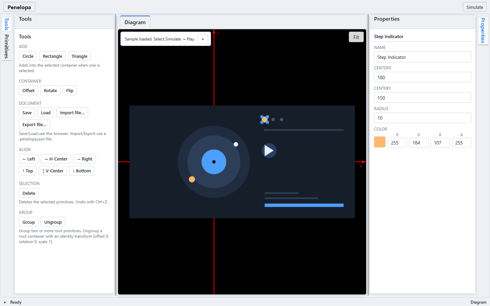
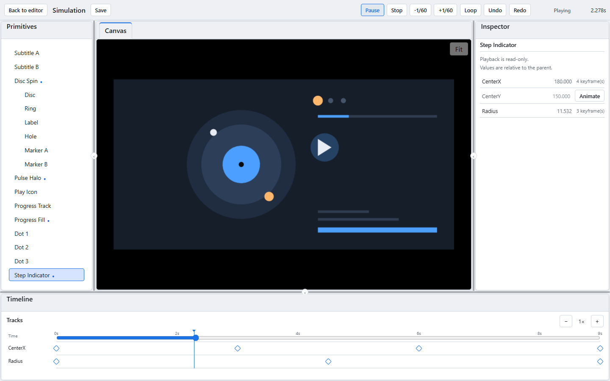

# Penelopa

English | [简体中文](README.zh.md)

**A primitive alignment editor and keyframe simulation workspace for Blazor WebAssembly.**

Penelopa hosts a SkiaSharp drawing canvas, a primitive tree, alignment actions, and a property editor inside a six-region dockable workspace, and provides six-direction alignment (left / horizontal-center / right / top / vertical-center / bottom) for circle, rectangle, and triangle primitives. A dedicated `/simulation` page turns Float properties into keyframe tracks for design validation and debugging.

> **Live demo:** https://HestiaLab.github.io/Penelopa/

> **v2-only documents (breaking change):** Penelopa now reads only version 2
> documents, from files and from localStorage. Version 1 and versionless
> documents are rejected by Load and Import with a migration hint. Export v1
> data with an older release **before** upgrading. A rejected v1 localStorage
> entry is left untouched; the first Save copies the old payload to
> `penelopa.document.backup` (one slot, later saves may overwrite it) and writes
> v2 to `penelopa.document`. See [ADR 0008](docs/adr/0008-v2-only-documents.md).

## Preview



Six-region dockable workspace: SkiaSharp drawing canvas, primitive tree, alignment tools, and property editor.



**Loop Study 01** is a bundled 9-second media-player sample with five keyframe tracks. The simulation page shows only the selected widget's two tracks while the rest of the scene keeps playing.

### Try the sample

1. Open the live demo.
2. In the empty editor, choose **Load Loop Study 01**.
3. Select **Simulate**, then **Play**.

The sample is a normal v2 document. The editor's **Import file…** / **Export file…** actions read and write the same `.penelopa.json` format without touching localStorage; you can also drag a `.penelopa.json` file anywhere over the editor. An import can be undone once until you edit, save, load, or import again.

## Features

- Six-region dockable workspace with Atlas top-toolbar/status-bar chrome
  (the status bar remains static; the top toolbar hosts the Simulate entry)
- Responsive side docks around a full-height drawing canvas; canvas width is
  roughly 731/643/504/436/381/327 CSS px at 1440/1280/1024/900/800/700
  viewports. Atlas 0.3.0 applies the 160–300px split constraints to splitter
  drags only; the initial proportional tracks are not clamped
- SkiaSharp canvas with color-key hit testing, Ctrl+wheel zoom, empty-space
  panning, and Fit-to-content
- Circle / Rectangle / Triangle primitives, containers, and hit-through
  drill-down selection
- Six-direction alignment against the union bounding box, with idempotence
- Property editor with validation, single- and multi-selection editing
  (shared values, conflict placeholders, atomic writes), rename, delete, and
  per-transaction undo/redo
- Group / ungroup root primitives with identity containers, one-transaction
  undo, and an explicit disabled/rejected path for non-identity ungrouping
- Keyboard canvas path: arrow keys nudge by 1 world unit (Shift = 10), Delete
  removes the selection, Escape cancels a gesture
- Dedicated `/simulation` page with a read-only canvas, local primitive tree,
  keyframe inspector, and a global timeline limited to the selected widget
- The simulation page hosts its own Atlas workspace: protected primitives,
  canvas, inspector and timeline regions; tool panels resize, collapse and
  dock, the canvas document cannot be closed or split, and the default layout
  is rebuilt on every entry
- Per-property Float keyframe tracks with linear/ease/step/cubic-bezier
  interpolation, scrubbing, 1/60s stepping, global loop, and 60 FPS playback
  (measured from SKGLView paint callbacks)
- Preview-only sessions restore base values exactly, including browser-back
  exits; Save is Ready-only, dormant tracks are reported with expandable
  details and per-track/remove-all cleanup (undoable), and the v2 document
  format persists the active animation configuration
- Editor document I/O: import/export `.penelopa.json` v2 files; import parses
  and shows primitive/track counts and warnings before replacing, and never
  writes localStorage. Import is strict UTF-8 (a BOM is accepted; UTF-16 and
  invalid byte sequences are rejected), warnings are length-capped, and Export
  uses the Save payload, warns when dormant tracks are excluded, and still works
  on an empty document
- One-level `Undo import` restores the previous document, selection, both
  undo/redo stacks and the simulation Loop; it is discarded by a persistent
  edit, configuration change, successful save, another import/Load, or reload
- Drag a `.penelopa.json` file anywhere over the editor to import it; the
  workspace shows a drop overlay and, if needed, activates Tools so the same
  confirmation is visible. A drop while another document operation is running
  is rejected with a workspace alert instead of being queued. The Import button
  remains the keyboard path, and the hidden file input is reset after each read
  so the same file can be selected again
- The empty editor offers a bundled **Loop Study 01** v2 sample; it loads into
  the editor, selects `Step Indicator`, and never autoplays. If the canvas
  changes (add, Import, or Load) while the sample request is in flight, the
  sample is canceled and a visible notice explains why
- The read-only simulation canvas hides the editor's coordinate axes for a
  clean presentation
- Property labels, inline errors, tree selection state and a polite live
  status region for assistive technology; browser page zoom is allowed
- Bright studio light/dark skin driven by `--penelopa-*` CSS variables

> Import rollback is editor-only and one level deep. Selection, viewport,
> Export and playback do not discard it; an actual document or simulation edit
> does.

## Project Structure

| Project                  | Responsibility                                          |
| ------------------------ | ------------------------------------------------------- |
| `src/Penelopa.Web`           | Blazor WebAssembly app hosting the editor and simulation page |
| `src/Penelopa.Core`      | UI-independent primitive model, history, alignment and simulation engine |
| `src/Penelopa.Rendering` | SkiaSharp canvas rendering and hit testing              |
| `tests/`                 | xUnit, bUnit (UI) and Playwright (E2E) test suites      |
| `docs/adr`               | Coordinate, history, selection, grouping, simulation and file I/O ADRs |

`Penelopa.Core` does not depend on Blazor or SkiaSharp. Browser input on the canvas is converted into a hit test against the color-key buffer, committed through the shared primitive service, and projected back by Blazor into the panels.

## Development

Requirements:

- .NET 6 SDK (`global.json` pins 6.0.428)
- `wasm-tools` workload — required by the SkiaSharp WebAssembly native assets:

```sh
dotnet workload install wasm-tools
```

- SkiaSharp is pinned to **2.88.9** (the last stable line that supports net6.0 WebAssembly; 4.x requires net8.0+).
- Node.js/npm is **optional for a normal .NET build**. The compiled
  `src/Penelopa.Web/wwwroot/js/penelopa.js` is committed and used when
  `node_modules/typescript` is absent. Node is required to modify
  `ts/penelopa.ts`, and for the JS/TS and Playwright suites. Run `npm ci`
  before building if you want the TypeScript target to recompile locally
  (CI always does).

```sh
dotnet restore Penelopa.sln
dotnet build Penelopa.sln --no-restore
dotnet test Penelopa.sln --no-build --no-restore
dotnet format Penelopa.sln --verify-no-changes --no-restore
```

Run the app:

```sh
dotnet run --project src/Penelopa.Web
```

TypeScript is compiled from `src/Penelopa.Web/ts` with `tsc`. With Node installed:

```sh
npm ci
npm run check:js
npm run test:js   # compiles TS and runs tests/js
```

UI/E2E tests need Node and Playwright:

```sh
npm ci
npm ci --prefix tests/e2e
npx --prefix tests/e2e playwright install chromium
npm run test:e2e
```

On Windows, setting `PLAYWRIGHT_CHANNEL=chrome` reuses the installed Google
Chrome instead of downloading Playwright's Chromium.

NuGet restores use committed `packages.lock.json` files. CI runs
`dotnet restore Penelopa.sln --locked-mode`; a local plain `dotnet restore`
may update the lock files when dependencies change. CI also audits both npm
package roots and NuGet dependencies for known vulnerabilities.

Dependency audit policy: High or Critical findings fail CI. A Moderate
AngleSharp mXSS advisory remains in bUnit's test-only DOM parser (AngleSharp
1.5 fixes it but is API-incompatible with bUnit 1.28/1.40). It has no production
exposure and is tracked for the S-01 test-stack migration; the audit is not
disabled and the risk is not reported as zero.

Periodic performance benchmark (editor idle CPU plus simulation tick rate,
selected 200-keyframe track and the 60s soak):

```sh
cd tests/e2e
PERF=1 npx playwright test tests/perf.spec.ts tests/simulation-perf.spec.ts
```

The benchmark reports JS rAF ticks, executed .NET frames and SKGLView paint
callbacks separately.

Coverage (Core ≥90%, Rendering ≥85% line; `Simulation/` and
`DocumentSerializer` also have per-file 90% gates):

```sh
dotnet test Penelopa.sln --collect:"XPlat Code Coverage" --results-directory artifacts/coverage
python3 scripts/check-coverage.py
```

## Documentation

| Document                                                 | Content                                                              |
| -------------------------------------------------------- | -------------------------------------------------------------------- |
| [Architecture (en)](docs/en/architecture.md)             | Layers, rendering, alignment semantics, accessibility, toolchain     |
| [Architecture (zh)](docs/zh/architecture.md)             | 中文架构说明                                                         |
| [Simulation requirements (zh)](docs/requirements/simulation.md) | Keyframe simulation v1 requirements (implemented) |
| [ADR 0001](docs/adr/0001-coordinate-spaces-and-setbounds.md) | Coordinate spaces and the `SetBounds` contract                    |
| [ADR 0002](docs/adr/0002-history-transactions-and-snapshots.md) | History transactions and snapshot contents                       |
| [ADR 0003](docs/adr/0003-selection-model.md)             | Selection normalization and multi-selection editing                  |
| [ADR 0004](docs/adr/0004-grouping-deferred.md)           | Grouping and ungrouping existing primitives                          |
| [ADR 0005](docs/adr/0005-simulation-keyframe-timeline.md) | Simulation keyframe timeline, preview isolation and persistence      |
| [ADR 0006](docs/adr/0006-simulation-atlas-workspace.md)  | Simulation Atlas workspace, protected regions and layout reset       |
| [ADR 0007](docs/adr/0007-document-file-import-export.md) | v2 JSON file import/export, bundled sample, and import rollback       |
| [ADR 0008](docs/adr/0008-v2-only-documents.md)           | v2-only reads, the v1 breaking change and legacy backup behavior     |

The GitHub Pages workflow is manual (`workflow_dispatch`); publishing is an
explicit release action.

## License

Penelopa is released under the [MIT License](LICENSE).
