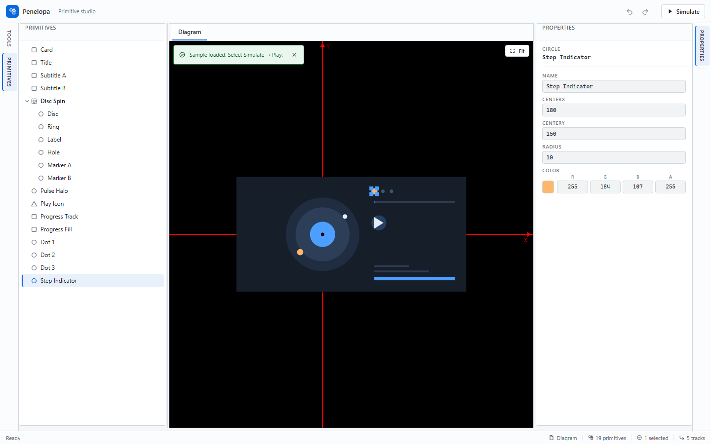

# Penelopa

[English](README.en.md) | 简体中文

**A primitive alignment editor and keyframe simulation workspace for Blazor WebAssembly.** · 面向 Blazor WebAssembly 的图元对齐编辑器与关键帧仿真工作区。

**定位**：需要在浏览器里摆放图元、做六方向对齐，并用关键帧仿真验证布局与动画的 Blazor WASM 开发者与设计验证人员；纯静态站点，不需要服务器或数据库。
**状态**：0.0.0-dev（主分支活跃开发中），尚未发布版本化 Release（依据：仓库无 tag、Releases 为空；`Directory.Build.props` 的 `Version` 为 `0.0.0-dev`）。在线演示由 `deploy-pages.yml` 手动触发部署，可能与 main 存在延迟。

[](https://github.com/HestiaLab/Penelopa/actions/workflows/ci.yml)
[](https://github.com/HestiaLab/Penelopa/actions/workflows/deploy-pages.yml)
[](LICENSE)

[在线演示](https://HestiaLab.github.io/Penelopa/) · [快速开始](#快速开始) · [文档](#文档) · [English](README.en.md)

<picture>
  <source media="(prefers-color-scheme: dark)" srcset="docs/assets/images/screenshot-dark.png">
  
</picture>

Penelopa 在六区域可停靠工作区中提供 SkiaSharp 画布、图元树、六方向对齐与强类型属性编辑器；独立的 `/simulation` 页面把 Float 属性编排为关键帧轨道，用于设计验证与调试。
内置 Loop Study 01 示例（5 条轨道、14 个关键帧、9 秒）可一键加载并播放。工作区基于 Atlas.Blazor 0.3.0，图元树使用 Astrea.Components。

> **仅支持 v2 文档：** Load 与 Import 只接受版本 2 的 `.penelopa.json` 文档；v1 与缺失版本文档会被拒绝并给出迁移提示，请在升级前用旧版本导出 v1 数据。当前行为详见[软件需求规格说明书](docs/软件需求规格说明书.md)。

## 界面预览


仿真工作区播放内置的 9 秒 Loop Study 01 示例，包含 5 条关键帧轨道。

## 试用示例

1. 打开在线演示。
2. 在空编辑器中选择 **Load Loop Study 01**。
3. 选择 **Simulate**，再按 **Play**。

> `Load Loop Study 01` 只在空画布出现。如果浏览器里已保存过文档，请先清除该站点数据；示例文件随应用发布在 `src/Penelopa.Web/wwwroot/samples/loop-study-01.penelopa.json`。

## 快速开始

环境要求：.NET 6 SDK（`global.json` 固定 6.0.428，`rollForward: latestFeature`，接受 6.0.4xx）与 `wasm-tools` workload。普通 .NET 构建不要求 Node.js；只有 TypeScript 与 Playwright 测试需要 Node。注意：.NET 6 已停止支持，新环境需自行评估运行时安全更新。

```sh
dotnet workload install wasm-tools
dotnet restore Penelopa.sln --locked-mode
dotnet build Penelopa.sln --no-restore
dotnet test Penelopa.sln --no-build --no-restore
dotnet run --project src/Penelopa.Web --no-build --urls http://127.0.0.1:5170
```

本机实测（Windows，.NET 6.0.428）：restore 约 607 MB；build 0 警告 0 错误；547 项测试通过。首次构建约 30 秒（不含还原）。应用默认地址为 `https://localhost:7162`，也可用 `--urls` 覆盖（上例为 5170）。

应用是纯静态 WebAssembly 站点，不需要服务器或数据库。工具链、质量门禁与依赖策略见[软件开发计划](docs/软件开发计划.md)与[软件测试规范](docs/软件测试规范.md)。

## 文档

| 文档 | 内容 |
| --- | --- |
| [软件开发计划](docs/软件开发计划.md) | 开发过程、里程碑、质量门禁、配置管理与风险 |
| [软件需求规格说明书](docs/软件需求规格说明书.md) | 产品需求、验收标准、限制与非目标 |
| [软件概要设计](docs/软件概要设计.md) | 总体架构、模块划分、数据流与关键方案 |
| [软件详细设计](docs/软件详细设计.md) | 契约、算法、文档格式、状态机与文件映射 |
| [软件测试规范](docs/软件测试规范.md) | 测试层级、环境、覆盖率与性能门禁、缺陷分级 |
| [软件测试报告](docs/软件测试报告.md) | 基线 `48cdf6d` 的冻结结果、覆盖率、性能与需求追溯 |

## 许可

Penelopa 以 [MIT 许可](LICENSE) 发布。
