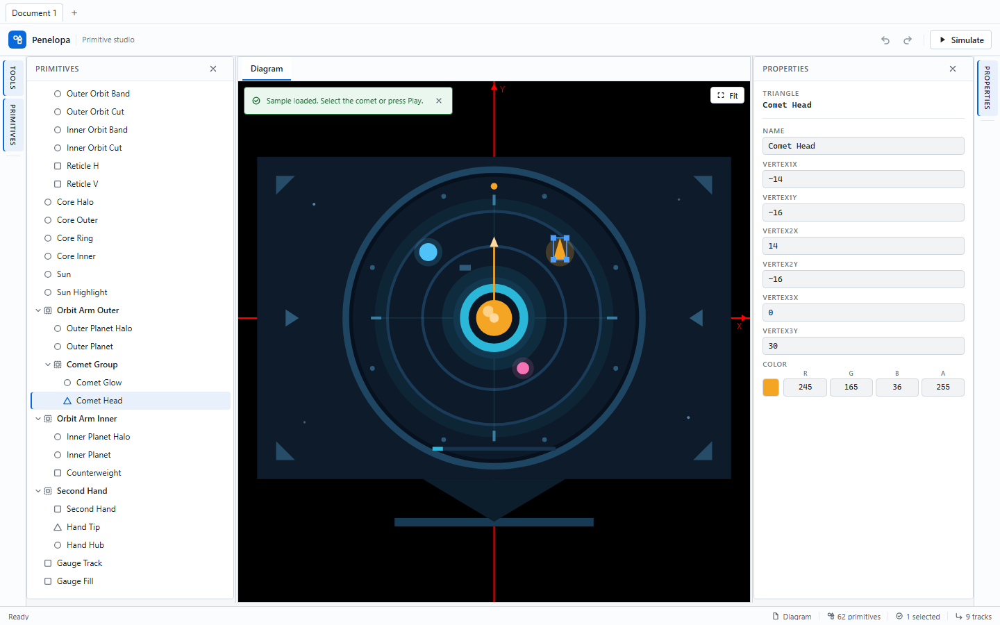
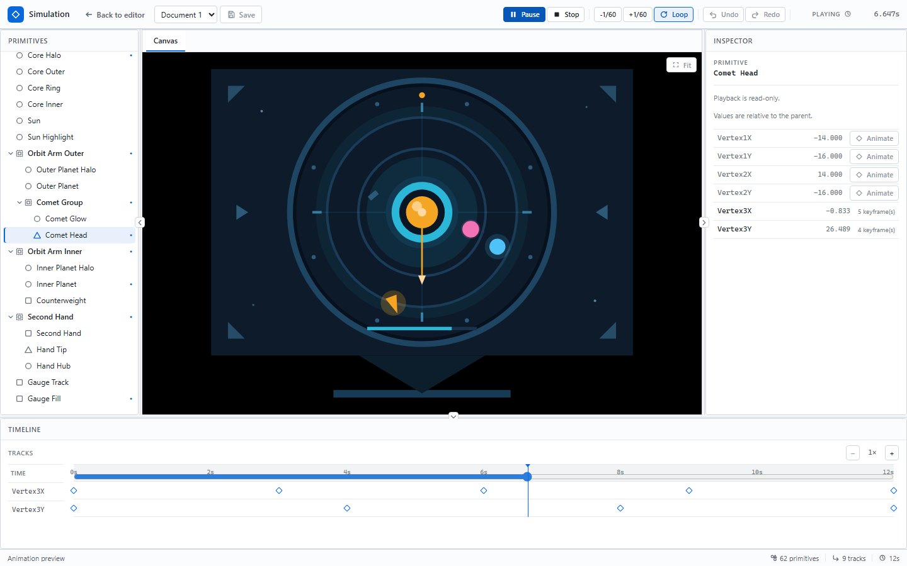

# Penelopa

[English](README.en.md) | 简体中文

**A primitive alignment editor and keyframe simulation workspace for Blazor WebAssembly.** · 面向 Blazor WebAssembly 的图元对齐编辑器与关键帧仿真工作区。

**定位**：需要在浏览器里摆放图元、做六方向对齐，并用关键帧仿真验证布局与动画的 Blazor WASM 开发者与设计验证人员；纯静态站点，不需要服务器或数据库。
**状态**：0.0.0-dev（主分支活跃开发中），尚未发布版本化 Release（依据：仓库无 tag、Releases 为空；`Directory.Build.props` 的 `Version` 为 `0.0.0-dev`）。在线演示由 `deploy-pages.yml` 手动触发部署，可能与 main 存在延迟。

[](https://github.com/HestiaLab/Penelopa/actions/workflows/ci.yml)
[](https://github.com/HestiaLab/Penelopa/actions/workflows/deploy-pages.yml)
[](LICENSE)

[在线演示](https://HestiaLab.github.io/Penelopa/) · [快速开始](#快速开始) · [文档](#文档) · [English](README.en.md)

<picture>
  <source media="(prefers-color-scheme: dark)" srcset="docs/assets/images/screenshot-dark.png">
  
</picture>

Penelopa 在可停靠工作区中提供 SkiaSharp 画布、图元树、六方向对齐与强类型属性编辑器；编辑页最多同时打开 3 个文档标签，各自拥有独立历史与仿真配置。独立的 `/simulation` 页面把 Float 属性编排为关键帧轨道，用于设计验证与调试。
内置 Loop Study 01 示例（5 条轨道、14 个关键帧、9 秒）可一键加载并播放。工作区基于 Atlas.Blazor 0.4.0，图元树使用 Astrea.Components 0.9.0。

> **仅支持 v3 文档：** Load 与 Import 只接受版本 3 的 `.penelopa.json` 文档；v1、v2 与缺失版本文档会被拒绝并给出原因。文档使用稳定 type id、`DocumentId`/`Revision`，未知 `Extensions` 段原样保留。详见[软件需求规格说明书](docs/软件需求规格说明书.md)。
>
> **本地恢复：** 持久编辑在 1.5 s 后写入 IndexedDB journal；刷新时若 journal 新于显式保存，或来自导入/样例产生的不同 `DocumentId`，会提示恢复或丢弃；恢复不包含撤销历史，显式 Save 会清理过期 journal。
>
> **多文档：** 编辑页最多同时打开 3 个标签；刷新恢复打开标签与内容；多会话先恢复显式保存内容，每个会话较新的 journal 单独通过恢复横幅确认。只剩一个会话时启动即恢复显式保存内容，较新的 journal 通过恢复横幅确认；显式保存过的文档可从标签栏的本地文档库重新打开；关闭的会话（含空会话）都会保留为文档库条目；未保存内容关闭前会提示，并在库中标记 unsaved。
>
> **平台基线（ADR-001）：** 运行时为 **.NET 10 LTS**；文档格式为 **v3-only**，不保留旧格式兼容（P0–P6 多文档会话已完成；云后端待选型）。详见[架构决策记录](docs/架构决策记录-001-文档历史与可扩展性重构.md)。

## 界面预览



仿真工作区播放内置的 9 秒 Loop Study 01 示例，包含 5 条关键帧轨道。

## 试用示例

1. 打开在线演示。
2. 在空编辑器中选择 **Load Loop Study 01**。
3. 选择 **Simulate**，再按 **Play**。

> `Load Loop Study 01` 只在空画布出现。如果浏览器里已保存过文档，请先清除该站点数据；示例文件随应用发布在 `src/Penelopa.Web/wwwroot/samples/loop-study-01.penelopa.json`。

## 快速开始

环境要求：.NET 10 SDK（`global.json` 固定 10.0.401，`rollForward: disable`）与 `wasm-tools` workload。普通 .NET 构建不要求 Node.js；只有 TypeScript 与 Playwright 测试需要 Node。

```sh
dotnet workload install wasm-tools
dotnet restore Penelopa.sln --locked-mode
dotnet build Penelopa.sln --no-restore
dotnet test Penelopa.sln --no-build --no-restore
dotnet run --project src/Penelopa.Web --no-build --urls http://127.0.0.1:5170
```

本机实测（Windows，.NET 10.0.401）：build 0 警告 0 错误；630 项 .NET 测试、35 项 JS 测试、77 项常规 E2E 与 5 项性能基准（Release，空闲主机）通过；Release publish 成功。首次 Debug 构建约 40 秒，Release 含 WASM 原生链接约 60 秒（不含还原）。应用默认地址为 `https://localhost:7162`，也可用 `--urls` 覆盖（上例为 5170）。

应用是纯静态 WebAssembly 站点，不需要服务器或数据库。工具链、质量门禁与依赖策略见[软件开发计划](docs/软件开发计划.md)与[软件测试规范](docs/软件测试规范.md)。

## 文档

| 文档 | 内容 |
| --- | --- |
| [软件开发计划](docs/软件开发计划.md) | 开发过程、里程碑、质量门禁、配置管理与风险 |
| [软件需求规格说明书](docs/软件需求规格说明书.md) | 产品需求、验收标准、限制与非目标 |
| [软件概要设计](docs/软件概要设计.md) | 总体架构、模块划分、数据流与关键方案 |
| [软件详细设计](docs/软件详细设计.md) | 契约、算法、文档格式、状态机与文件映射 |
| [软件测试规范](docs/软件测试规范.md) | 测试层级、环境、覆盖率与性能门禁、缺陷分级 |
| [软件测试报告](docs/软件测试报告.md) | 基线 `48cdf6d` 的冻结结果，以及 P6 增量验证快照 |
| [架构决策记录 ADR-001](docs/架构决策记录-001-文档历史与可扩展性重构.md) | 历史模型、写入边界、预算、持久化、扩展性与分阶段重构决策（P0–P6 本地完成，云后端待选型） |

## 许可

Penelopa 以 [MIT 许可](LICENSE) 发布。
