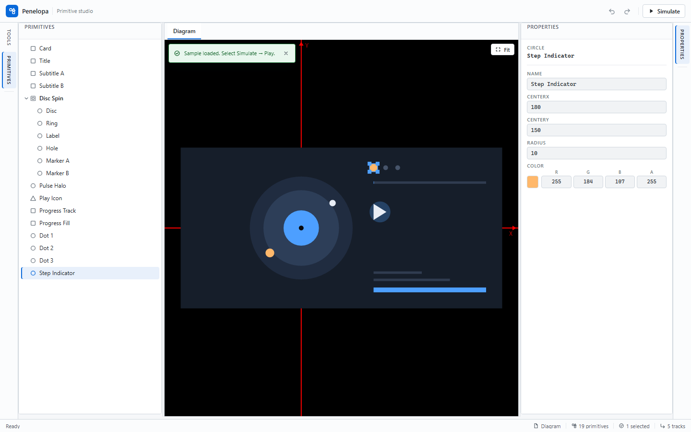

# Penelopa

[English](README.md) | 简体中文

**面向 Blazor WebAssembly 的图元对齐编辑器与关键帧仿真工作区。**

Penelopa 在六区域可停靠工作区中承载 SkiaSharp 绘制画布、图元树、六方向对齐与强类型属性编辑器。独立的 `/simulation` 页面把 Float 属性编排为关键帧轨道，用于设计验证与调试。

> **在线演示：** https://HestiaLab.github.io/Penelopa/

> **仅支持 v2 文档：** Load 与 Import 只接受版本 2 的 `.penelopa.json` 文档；v1 与缺失版本文档会被拒绝并给出迁移提示，请在升级前用旧版本导出 v1 数据。当前行为详见[软件需求规格说明书](docs/软件需求规格说明书.md)。

## 界面预览



六区域可停靠工作区：SkiaSharp 画布、图元树、对齐工具与属性编辑器。


仿真工作区播放内置的 9 秒 Loop Study 01 示例，包含 5 条关键帧轨道。

## 试用示例

1. 打开在线演示。
2. 在空编辑器中选择 **Load Loop Study 01**。
3. 选择 **Simulate**，再按 **Play**。

## 快速开始

环境要求：.NET 6 SDK（固定 6.0.428）与 `wasm-tools` workload。普通 .NET 构建不要求 Node.js；只有 TypeScript 与 Playwright 测试需要 Node。

```sh
dotnet workload install wasm-tools
dotnet restore Penelopa.sln
dotnet build Penelopa.sln --no-restore
dotnet test Penelopa.sln --no-build --no-restore
dotnet run --project src/Penelopa.Web
```

应用是纯静态 WebAssembly 站点，不需要服务器或数据库。工具链、质量门禁与依赖策略见[软件开发计划](docs/软件开发计划.md)与[软件测试规范](docs/软件测试规范.md)。

## 文档

| 文档 | 内容 |
| --- | --- |
| [软件开发计划](docs/软件开发计划.md) | 开发过程、里程碑、质量门禁、配置管理与风险 |
| [软件需求规格说明书](docs/软件需求规格说明书.md) | 产品需求、验收标准、限制与非目标 |
| [软件概要设计](docs/软件概要设计.md) | 总体架构、模块划分、数据流与关键方案 |
| [软件详细设计](docs/软件详细设计.md) | 契约、算法、文档格式、状态机与文件映射 |
| [软件测试规范](docs/软件测试规范.md) | 测试层级、环境、覆盖率与性能门禁、缺陷分级 |
| [软件测试报告](docs/软件测试报告.md) | 基线 `48cdf6d` 的冻结结果、覆盖率、性能与需求追溯 |

## 许可

Penelopa 以 [MIT 许可](LICENSE) 发布。
